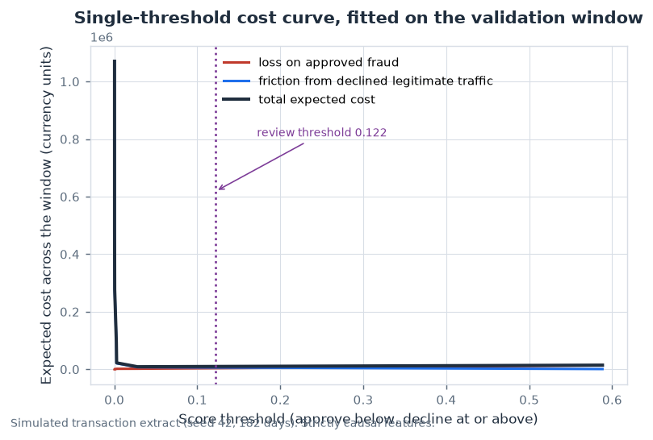
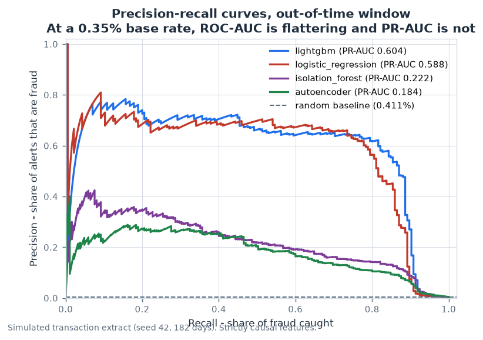
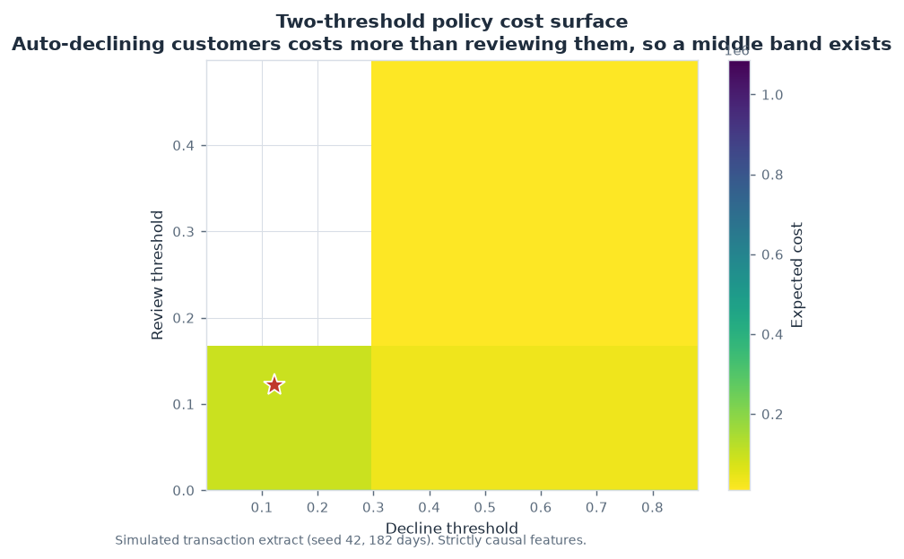
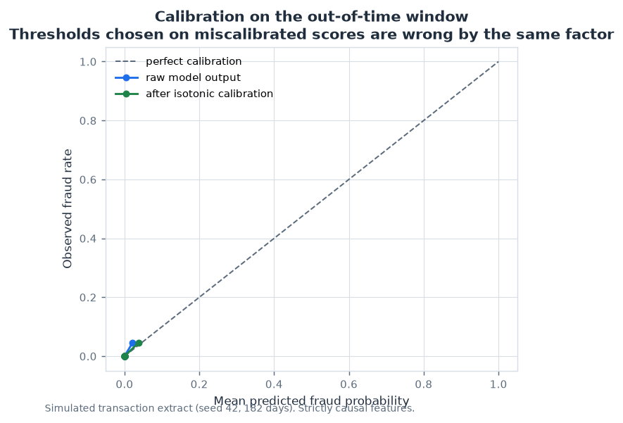
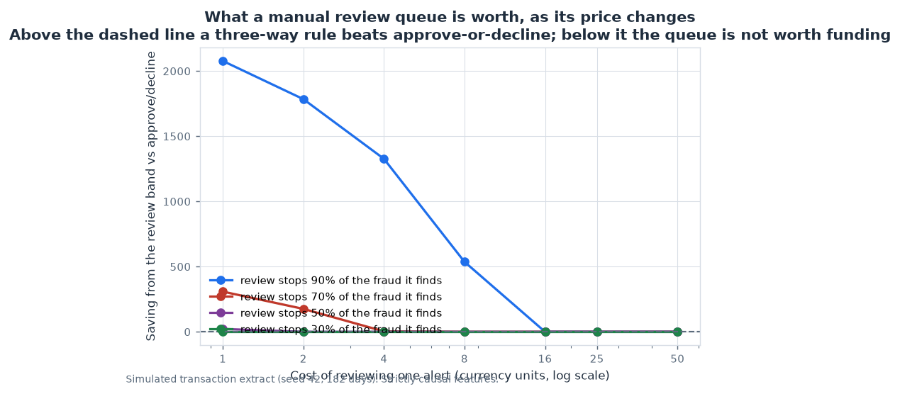
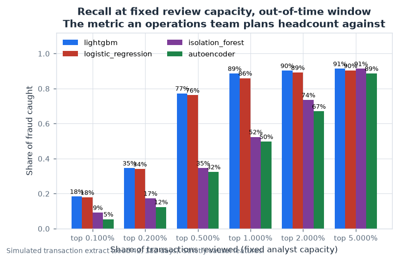
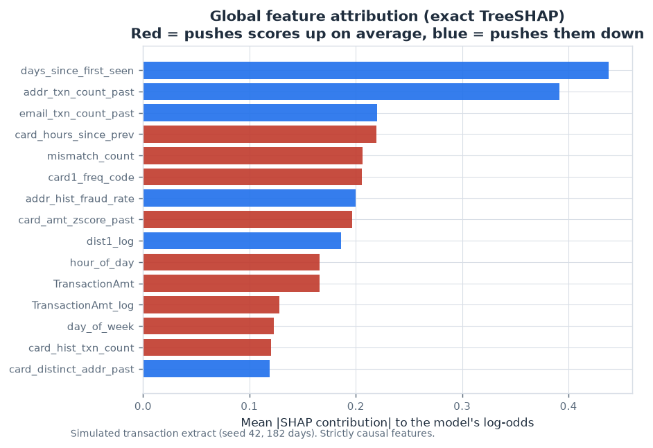
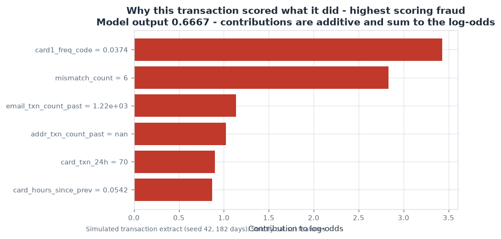
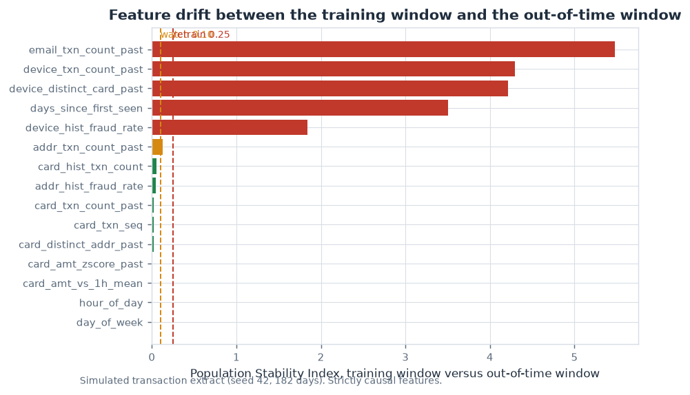
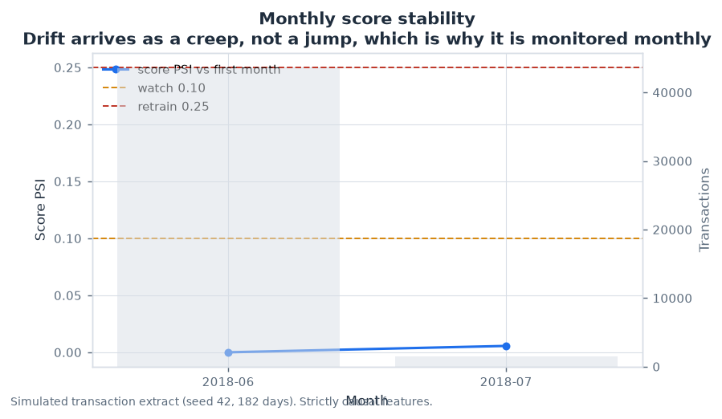

# Payment Fraud Analytics


Cost-sensitive detection of card-not-present payment fraud: causal SQL features
built in a warehouse, an imbalance study that measures its own optimism, a
cost-optimal three-way decision rule, and per-transaction SHAP attribution
served over HTTP.

The target here is not a leaderboard score. It is the set of things a fraud
analytics team has to get right before a model is allowed near a production
queue: features that cannot see the future, a validation protocol that does not
flatter itself, a decision rule priced in money rather than F1, and an
explanation an analyst can act on.

```
300,001 transactions · 0.35% fraud · 46 causal features · 4 models compared
out-of-time PR-AUC 0.5782 · ROC-AUC 0.9511 · 84% of fraud captured at 0.6% refusal
```

---

## Why this repository exists

The prototypical fraud project reports a ROC-AUC of 0.98 on a 0.35% base rate
and stops there. Three specific things are wrong with that, and this repository
is built around fixing them rather than around the model.

**The number is inflated by the protocol, not by the model.** Resampling before
the train/test split lets a synthetic point be interpolated between a validation
row and its neighbours. The reported score rises by hundreds of PR-AUC points
and the model has not improved at all. Section 3 measures the size of that
effect on identical data with four protocols that differ by one thing at a time.

**Accuracy and ROC-AUC cannot answer the question the business is asking.** At a
0.35% base rate an all-negative classifier is 99.65% accurate, and ROC-AUC is
dominated by the 99.65% of rows that are easy. The operative question is "of the
X% of transactions we can afford to touch, how much fraud is inside?", which is
a precision-recall question with a capacity constraint attached.

**A probability threshold is not a decision.** Whether to approve, review or
decline is a cost trade-off: a review costs an analyst's time and only partially
stops the fraud, a decline stops it outright but burns goodwill when the
customer was innocent. That trade-off has a globally optimal answer, and it is
not 0.5.

---

## Results at a glance

Out-of-time window: 45,001 transactions the model never saw, strictly later in
time than training, carrying genuine drift.

| | |
|---|---|
| **PR-AUC** | **0.5782** (95% bootstrap interval 0.5002 - 0.6638) |
| Random baseline | 0.4111%, so the PR-AUC is **141×** the no-skill value |
| **ROC-AUC / KS** | 0.9511 / 0.8887 |
| **Recall @ 1% review capacity** | **88.6%** |
| Recall @ 5% review capacity | 90.3% |
| Cost of the fitted policy | **5,561** vs **20,387** for approving everything |
| Accuracy | deliberately not reported (see below) |

The cost comparison is the headline: the same model with a fixed 0.5 threshold
loses 14,994 on that window and doing nothing at all loses 20,387. The decision
rule, not the model, is where two thirds of the available saving lives.



---

## Quickstart

```bash
python -m pip install -r requirements.txt

make pipeline          # generate data, build the warehouse, fit, evaluate, report
make test              # 127 tests
make lint              # ruff
make serve             # scoring API on :8000
```

`make pipeline` takes about nine minutes at the default 300,000 transactions
and writes everything into `outputs/`. For a quick run:

```bash
python scripts/run_pipeline.py --transactions 60000
```

To run against the real IEEE-CIS competition extract instead of the simulator,
put the CSVs in `data/raw/` and pass `--data-mode real`. The warehouse, the
encoder and every model are shared between the two paths; only the loader
differs.

---

## Repository layout

```
sql/                        the feature layer, as SQL
  01_staging.sql              typing, de-duplication, amount filters, indexes
  02_data_quality.sql         22 assertions written to a table, not to stdout
  03_features.sql             window functions; strictly backward frames
  04_feature_mart.sql         production mart, vendor mart, governance view
src/frauddetect/
  config.py                   every tunable in one place
  data.py                     the simulator, and the IEEE-CIS loader
  warehouse.py                statement-by-statement SQL execution
  features.py                 frozen-vocabulary encoder, leakage guard
  models.py                   logistic, LightGBM, isolation forest, autoencoder
  evaluate.py                 ranking metrics, calibration, cost optimisation
  imbalance.py                resampling comparison and the leakage ablation
  explain.py                  exact TreeSHAP, permutation, case attribution
  drift.py                    PSI, KS, monthly stability
  api.py                      scoring service and the serialised bundle
scripts/run_pipeline.py       the nine-stage end-to-end entry point
  report.py                   renders RESULTS.md and the metrics bundle
tests/                      127 tests
outputs/                    figures, tables, metrics, RESULTS.md (all committed)
```

---

## 1. Data

The repository runs on a simulator rather than a committed CSV, because a
300,000-row payment extract is both too large for a repository and, in the real
world, not something anyone is allowed to publish.

The simulator is not "random rows plus a random label". It generates **account
takeover episodes**, which is what card fraud actually looks like:

* an episode strikes a card for a short burst, not a single transaction;
* it starts with small "card testing" probes and escalates the amount;
* a card that has been attacked once is more likely to be attacked again;
* episodes share a rotating pool of devices, so compromised cards form device
  rings that move over time;
* legitimate customers have spending sprees of their own, which is what makes
  the problem hard rather than merely imbalanced;
* fraud pressure rises over the six months and amounts inflate, so the
  out-of-time window is genuinely different from the training window.

Everything the generator does is recorded in `outputs/generator_manifest.json`.
The properties the downstream code depends on — backward-looking windows,
lagged labels, and a positive signal — are asserted in the test suite rather
than assumed.

Both paths produce the same schema, including the columns the model is **not**
allowed to use.

---

## 2. The SQL feature layer

`sql/03_features.sql` and `sql/04_feature_mart.sql` build the training table with
window functions. The file opens with the two rules the whole layer obeys, and
the test suite checks both.

**Rule 1 — windows look strictly backwards.** Every velocity feature uses a
frame that ends before the current row:

```sql
COUNT(*) OVER (
    PARTITION BY card1
    ORDER BY TransactionDT, TransactionID
    RANGE BETWEEN 86400 PRECEDING AND 1 PRECEDING
) AS card_txn_24h
```

`test_velocity_features_only_look_backwards` recomputes `card_txn_seq` with an
independent pandas groupby-cumcount and asserts the two agree row for row.

**Rule 2 — a label may only be used once it has resolved.** Chargebacks resolve
about sixty days after the transaction, so a feature that counts a card's past
frauds must exclude everything inside the resolution window. Otherwise the
current row contributes to its own feature.

```sql
RANGE BETWEEN UNBOUNDED PRECEDING AND 5184000 PRECEDING   -- 60 days
```

`test_label_based_features_exclude_the_unresolved_period` replays the whole file
in Python and checks the eligible-history count for every row.

Two constraints shaped the SQL in ways worth naming. SQLite does not support
`DISTINCT` inside a window function, so distinct-entity counts are built from a
first-occurrence flag plus a running sum. And the identity table is joined with
`LEFT JOIN`, preserving "this transaction has no identity record" as NULL rather
than collapsing it to a zero — in this data the *absence* of identity coverage
is itself one of the strongest signals.

### Leakage guards

Some columns look like features and are not. `chargeback_amount`,
`chargeback_days` and `case_closed` are only known after the fact. The vendor's
aggregate counters `C1`-`C6` include a forward-looking seven-day count and a
deviation from an all-time mean, so they see transactions that had not happened
yet.

These are kept in the mart — an audit needs them — but they are excluded from
the production feature set and listed in a `feature_governance` view with an
explicit role. `assert_no_forbidden_features` is a hard gate that fails the
pipeline rather than emitting a warning.

Their cost is then **measured** rather than asserted:

| feature set | features | test PR-AUC | OOT PR-AUC | gap |
|---|---|---|---|---|
| causal features only | 46 | 0.4614 | 0.6044 | — |
| plus vendor counters | 52 | 0.4945 | 0.6181 | **+0.0137** |

Six leaked columns buy 0.0137 of PR-AUC. That is the price of shipping the
vendor's convenience columns, and it is a number, not an opinion.

---

## 3. The imbalance study

At a 0.35% base rate the resampling choice is the loudest knob in the pipeline,
and the literature on it is undermined by a protocol error that is easy to make
and hard to see.

**The error.** Applying SMOTE to the whole dataset and *then* splitting into
folds. Each synthetic minority point is a convex combination of two real
neighbours, so a validation row's nearest neighbours include the synthetic
points interpolated from itself. The model is evaluated on a smoothed copy of
its own training data.

The ablation holds the data and the model fixed and changes one thing at a time:

| variant | resampling placement | fold protocol | mean PR-AUC |
|---|---|---|---|
| A | whole window, before folding | random stratified 5-fold | **0.9948** |
| B | inside each fold | random stratified 5-fold | 0.4884 |
| C | inside each fold | forward-chaining, 4 folds | 0.4899 |
| D | none | forward-chaining, 4 folds | 0.4430 |

| contrast | isolates | value |
|---|---|---|
| A − C | what a typical tutorial reports | **+0.5050** |
| A − B | where the resampling happened | +0.5065 |
| B − C | the fold protocol alone | −0.0015 |
| C − D | what the resampling machinery is worth | +0.0469 |

Read the bottom row against the third: the sampler is worth about **0.047**, and
the *placement* of the sampler is worth about **0.507**. Two thirds of the
improvement a tutorial would report comes from evaluating on leaked data. This is
the single most useful paragraph in the repository.

The sampler comparison itself is on the honest protocol:

| strategy | mean PR-AUC | sd | rows used | share of data |
|---|---|---|---|---|
| SMOTE-ENN (5% minority) | **0.5145** | 0.0602 | 85,523 | 71% |
| random undersample 10:1 | 0.5050 | 0.0506 | 3,443 | **2.9%** |
| SMOTE (5% minority) | 0.4899 | 0.0300 | 86,295 | 72% |
| unweighted baseline | 0.4430 | 0.0305 | 82,500 | 69% |
| `class_weight='balanced'` | 0.1123 | 0.0601 | 82,500 | 69% |

Two findings that matter more than the ranking. Random undersampling reaches
within 0.01 of the best score using **2.9% of the data** — on a production
pipeline that is a two-order-of-magnitude difference in training cost for a
rounding error of accuracy. And `class_weight` does not merely underperform, it
**collapses to 0.1123 with a ROC-AUC of 0.5647**, barely above chance. A
plausible-sounding default that is quietly catastrophic is worth knowing about
before it reaches production.

---

## 4. Model comparison

Four models on the same causal features, scored on the out-of-time window:

| model | test PR-AUC | OOT PR-AUC | OOT ROC-AUC | OOT KS |
|---|---|---|---|---|
| LightGBM | 0.4614 | **0.6044** | 0.9500 | 0.8927 |
| logistic regression | 0.4427 | 0.5879 | 0.9500 | 0.8813 |
| isolation forest | 0.1458 | 0.2221 | 0.9567 | 0.8694 |
| autoencoder | 0.1047 | 0.1838 | 0.9579 | 0.8484 |



Both unsupervised detectors post a **higher ROC-AUC** than either supervised
model and a **PR-AUC two to three times worse**. This is the clearest
illustration of why the metric choice is not a detail: at this base rate ROC-AUC
is close to blind, and a detector that has learned nothing about fraud can still
score 0.96 on it because it is mostly measuring "is this transaction unusual",
and unusual is common.

The autoencoder is trained only on legitimate transactions, which is the
standard recipe and the reason it ranks so poorly: *most fraud is not
anomalous*. An episode that mimics normal spending patterns is invisible to it.

---

## 5. Cost-sensitive decisioning

### The cost model

```python
fraud_loss_ratio     = 1.00   # an approved fraud loses the full amount
review_cost          = 8.00   # an analyst's time, per alert
decline_friction_cost= 25.00  # goodwill burnt when the customer was innocent
min_review_amount    = 5.00   # below this, an analyst costs more than the exposure
review_catch_rate    = 0.70   # a review only stops 70% of the fraud it finds
max_review_rate      = 0.02   # share of daily volume the team can physically work
```

`review_catch_rate` is the parameter that is usually left out and is the reason a
three-way rule exists at all. A review is **not** a guaranteed save: the analyst
queue has latency, and a transaction that has already authorised and settled
cannot be recalled. Once a review only stops 70% of what it finds, declining
becomes the right action for the alerts that are almost certainly fraudulent,
even though it costs 25 when the customer was innocent.

### Why the threshold is not 0.5

With actions ordered approve < review < decline and costs additive across the
three bands, the total cost of a cut pair decomposes into a term depending on the
first cut plus a term depending on the second. A suffix minimum then yields the
**global** optimum in a single O(k) pass, where k is the number of distinct
scores. No grid search, no local minimum.



Two implementation details that decide whether the reported number is true:

**Cuts are taken between distinct score values, never between two rows that share
a score.** A threshold rule can only express `score >= t`, so two rows with the
same score can never receive different actions. Optimising over per-row positions
would let the search "decide" to split a tied block, bank the gain, and then be
unable to implement it — and because the reported cost is recomputed by applying
the thresholds, a two-threshold policy would come out *more expensive* than the
single-threshold policy it claims to dominate. Grouping first makes the
optimiser's objective and the realised cost the same number by construction.
This is not hypothetical: isotonic calibration maps many raw scores onto one
probability, so on a 45,000-row book the calibrated score takes fewer than forty
distinct values and the ties are wide.

**The capacity cap is on transactions, not on score tiers.** Tiers hold different
numbers of rows, so the furthest legal cut is a monotone function of the first
cut, and a deque maintains the running minimum in O(k).

`test_a_discretised_score_never_claims_a_gain_it_cannot_implement` and
`test_capacity_capped_optimum_matches_the_constrained_brute_force` pin both of
these against an exhaustive search over every legal cut pair.

### The policy

Thresholds are fitted on the validation window and then **frozen**. Applied
unchanged to 45,001 unseen transactions:

| policy | expected cost | cost/10k | review % | decline % | fraud captured |
|---|---|---|---|---|---|
| approve everything | 20,387 | 4,530 | — | — | 0% |
| fixed 0.5 threshold | 14,994 | 3,332 | 0% | 0.18% | 31.4% |
| **fitted policy (frozen)** | **5,561** | **1,236** | **0%** | **0.62%** | **84.3%** |

A fixed 0.5 threshold — the reflex choice — captures 31% of the fraud and loses
**2.7× more money** than the fitted rule. The raw score is not a probability, so
0.5 has no reason to be the right cut. This is what calibration is for:


### ...and why the fitted policy has only two actions

The three-way rule is implemented, globally optimal, and available. On this book
its optimum **collapses to approve-or-decline**: the review band is empty.

That is a result, not a bug, and it is worth being precise about why. The
decision is a threshold rule, so a band can only be drawn between two *distinct*
score values. Isotonic calibration maps many raw scores onto one probability, so
the flagged tail is a handful of wide tiers rather than a fine gradient. A review
band has to be a whole tier, which at this base rate means paying $8 to look at a
mixed block of alerts to stop a handful of frauds — and the arithmetic does not
work. The pipeline verifies this is not an artefact of the calibration choice: a
Platt-scaled score and the raw uncalibrated score, both of which have 45,000
distinct values, give the same empty band.

Rather than tune the cost model until a band appeared, the pipeline **sweeps the
price of an analyst alert** and reports where the answer flips:



| alert cost | catch 30% | catch 50% | catch 70% | catch 90% |
|---|---|---|---|---|
| 1 | 0 | +22 | +308 | **+2,078** |
| 2 | 0 | 0 | +176 | +1,785 |
| 4 | 0 | 0 | +3 | +1,327 |
| 8 *(shipped)* | 0 | 0 | **0** | +537 |
| 16 | 0 | 0 | 0 | 0 |

At the configured 70% catch rate the queue pays for itself only while an alert
costs about **4 or less**; the shipped price is 8, which is on the wrong side of
that line. Two things follow, and they are more useful than a wider band would
have been.

**The queue's price is not the main lever — its hit rate is.** Cutting the
analyst cost from 8 to 1 buys about 308 on the validation window. Raising the
fraction of reviewed fraud that is actually stopped, from 70% to 90%, buys 537 at
the *unchanged* price. A review that only catches part of what it finds has
already lost most of the money by the time anyone looks at it.

**"Should we fund a manual review queue?" is answerable.** The pipeline returns
the break-even instead of an opinion, which is the form the question arrives in.



---

## 6. Model explanation

Two different questions, two different answers.

**Which features drive the model overall?** Mean absolute SHAP, cross-checked
against permutation importance on PR-AUC:

| feature | mean abs SHAP | share | what it is |
|---|---|---|---|
| `days_since_first_seen` | 0.4377 | 10.4% | account age at the merchant |
| `addr_txn_count_past` | 0.3911 | 9.3% | how busy the billing address is |
| `email_txn_count_past` | 0.2200 | 5.2% | how busy the email domain is |
| `card_hours_since_prev` | 0.2192 | 5.2% | velocity |
| `mismatch_count` | 0.2063 | 4.9% | AVS/CVV disagreement count |
| `card1_freq_code` | 0.2055 | 4.9% | card frequency, fitted on train only |



Permutation importance is computed by shuffling **the DataFrame column**, not a
NumPy array, so LightGBM's native categorical splits survive the shuffle. A
conversion to `ndarray` would silently permute within integer codes and the
attributions would describe a different model from the one being served.

**Why did *this* transaction score what it did?** Exact TreeSHAP contributions on
the raw margin, which are additive and therefore checkable by hand. For the
highest-scoring fraud in the out-of-time window:

| feature | value | contribution |
|---|---|---|
| `card1_freq_code` | 0.0374 | +3.43 |
| `mismatch_count` | 6 | +2.83 |
| `email_txn_count_past` | 1,223 | +1.14 |
| `addr_txn_count_past` | *missing* | +1.02 |
| `card_txn_24h` | 70 | +0.90 |



A missing value is rendered as `missing`, not `nan`, because a third of this
design matrix is entity history and "no identity record exists for this card" is
frequently the strongest signal in the row. An analyst who sees `nan` learns
nothing; one who sees `missing` learns what the model reacted to.

`ShapExplainer.shap_values_library` computes the same quantity through the
`shap` package, and the test suite asserts the two agree — two independent
implementations producing the same numbers is the strongest evidence available
that the attribution is right.

---

## 7. Drift monitoring

Population stability index against a frozen reference distribution, plus a KS
test on the score itself:

```
PSI 10.5737 -> retrain        KS 0.9315 (p < 1e-300)
reference mean score 0.001948 -> actual 0.003311
```




The verdict here is `retrain`, and it is the correct answer rather than a
malfunction: the out-of-time window is six months after training, fraud pressure
in the simulator rises over that period by construction, and the mean score
nearly doubles. A monitor that stayed silent would be the broken thing.

The reference bins are frozen at fit time. Re-deriving them from the incoming
window would make every distribution look stable by definition, which is the
most common way a drift monitor is quietly disabled.

---

## 8. Serving

```bash
make serve
```

A thin request — only the fields a checkout page actually knows:

```bash
curl -X POST localhost:8000/score -H 'Content-Type: application/json' -d '{
  "features": {
    "TransactionAmt": 138.78, "ProductCD": "C", "card4": "visa", "card6": "credit",
    "card1_freq_code": 0.03742, "mismatch_count": 6, "card_txn_24h": 70,
    "card_txn_1h": 14, "email_txn_count_past": 1223, "hour_of_day": 4,
    "TransactionAmt_log": 4.933, "is_night": 1
  }
}'
```

```json
{
  "score": 0.076923,
  "raw_score": 0.005359,
  "decision": "approve",
  "review_threshold": 0.121795,
  "decline_threshold": 0.121795,
  "model_version": "lightgbm-seed42-300000rows",
  "top_drivers": [
    {"feature": "card1_freq_code", "value": 0.03742, "contribution": 2.3151, "direction": "increases risk"},
    {"feature": "mismatch_count", "value": 6.0, "contribution": 1.6687, "direction": "increases risk"},
    {"feature": "card_txn_count_past", "value": null, "contribution": -1.0921, "direction": "decreases risk"}
  ],
  "narrative": "Score log-odds -7.685 against a base of -11.616. Largest drivers: card1_freq_code=0.0374 (increases risk, +2.315); mismatch_count=6 (increases risk, +1.669); card_txn_count_past=missing (decreases risk, -1.092)."
}
```

That request looks alarming — a card seen 0.037% of the time, six identity mismatches,
seventy transactions in a day — and it is **approved**, which is the point. The
endpoint takes the **engineered feature vector**, not a raw transaction, and a
thin client cannot supply it. Velocity and entity history come from a streaming
feature store; a model server that quietly recomputed them from one request would
produce a different number from the one the warehouse produced, and that is how
training/serving skew gets introduced.

Send the same transaction with its history and the answer is different. This is
the highest-scoring fraud in the out-of-time window, scored through the service:

```json
{
  "score": 0.666667,
  "raw_score": 0.985735,
  "decision": "decline",
  "model_version": "lightgbm-seed42-300000rows",
  "top_drivers": [
    {"feature": "card1_freq_code", "value": 0.03742, "contribution": 3.4314, "direction": "increases risk"},
    {"feature": "mismatch_count", "value": 6.0, "contribution": 2.8338, "direction": "increases risk"},
    {"feature": "email_txn_count_past", "value": 1223.0, "contribution": 1.1360, "direction": "increases risk"},
    {"feature": "addr_txn_count_past", "value": null, "contribution": 1.0243, "direction": "increases risk"},
    {"feature": "card_txn_24h", "value": 70.0, "contribution": 0.9020, "direction": "increases risk"}
  ],
  "narrative": "Score log-odds -3.190 against a base of -11.616. Largest drivers: card1_freq_code=0.0374 (increases risk, +3.431); mismatch_count=6 (increases risk, +2.834); email_txn_count_past=1.22e+03 (increases risk, +1.136); addr_txn_count_past=missing (increases risk, +1.024)."
}
```

Missing history is **omitted**, not sent as `0` or `NaN`. JSON cannot represent
`NaN`, and "this card has no previous transaction" is a different statement from
"this card has zero previous transactions" — the model was trained on the
distinction, so the API has to preserve it. The service renders absent history
back out as `null`, and the narrative says `missing` rather than `nan`.

`GET /health`, `GET /model/info` (thresholds, cost model, metrics) and
`POST /score/batch` complete the surface. A `Dockerfile` is included.

---

## Reproducing this exactly

Every number in this README is produced by one command from a fixed seed. Nothing
is hand-entered, and `outputs/RESULTS.md` is generated by the pipeline.

```bash
python -m pip install -r requirements.txt
python scripts/run_pipeline.py --transactions 300000
```

The nine stages, in order: build the warehouse → fit the encoder → compare
resampling policies and run the leakage ablation → fit four models → calibrate
and choose thresholds → score both windows → measure vendor-counter leakage →
explain and monitor drift → render figures and write the report.

The validation protocol is stated once, at the top of `report.py`, so every
number can be traced to it:

| window | share | used for |
|---|---|---|
| train | 70% | fitting model weights, fitting encoder vocabularies |
| test | 15% | calibration and threshold selection only |
| out-of-time | 15% | evaluation only — touched by nothing that fits anything |

`--transactions` and `--seed` change the size and the draw; the protocol does not
move.

---

## Testing

```bash
make test     # 127 tests, ~80s
```

The tests are mostly about what the code must *refuse* to do. The ones that
carry the most weight:

| test | what it prevents |
|---|---|
| `test_velocity_features_only_look_backwards` | a window frame that includes the current row, checked against an independent pandas computation |
| `test_label_based_features_exclude_the_unresolved_period` | a label leaking into its own feature through the 60-day resolution lag |
| `test_a_discretised_score_never_claims_a_gain_it_cannot_implement` | an optimiser reporting a saving that no threshold can express |
| `test_capacity_capped_optimum_matches_the_constrained_brute_force` | a deque that silently returns a suboptimal capped policy |
| `test_a_review_that_can_never_save_anything_is_never_ordered` | spending the analyst budget when the catch rate is zero |
| `test_the_review_band_opens_when_reviews_get_cheap_enough` | a sensitivity sweep that silently always reports "no band" |
| `test_a_cheaper_queue_can_only_ever_help` | a sweep comparing incomparable objectives |
| `test_frequency_encoding_is_a_lookup_fitted_on_the_training_window` | frequency coding fitted on the full file instead of on train |
| `test_leakage_ablation_is_self_consistent` | an ablation whose contrasts stop reconciling |
| `test_absent_history_is_returned_as_null_not_a_broken_response` | a 500 on the alert endpoint because a feature was missing |
| `test_two_threshold_optimum_matches_brute_force` | the O(k) fast path drifting from the specification, checked against exhaustive enumeration |

CI runs the suite and then the **full pipeline** on a reduced extract, because a
pipeline that only passes unit tests is a pipeline nobody has run.

---

## Limitations

Stated plainly, because a project that lists no weaknesses has not been examined.

* **The data is simulated.** It is built to contain the structure the methods are
  meant to exploit — episode clustering, velocity, device rings, time drift — and
  its properties are asserted in tests, but it is not real. Every mechanism is
  recorded in `generator_manifest.json` so the assumptions are auditable rather
  than buried.
* **The cost model is an assumption, not an estimate.** `review_cost = 8` and
  `decline_friction_cost = 25` are plausible for an issuer and would have to be
  replaced with that issuer's measured numbers. The optimum is highly sensitive
  to the friction term, which is why it is a single named constant with a
  documented rationale rather than a literal in the optimiser.
* **`max_review_rate` is a guardrail, not a measured capacity.** Real queues have
  a service level that varies by hour; a single cap flattens that.
* **The three-way review band is thin on this book** (section 5). The machinery
  is correct and the optimum is global; the band is narrow because the model's
  ranking is decisive relative to the cost of an alert. A cheaper queue or a lower
  catch rate would widen it.
* **The OOT window is the last 15% of one synthetic run.** It carries drift, but
  a single window is a single draw; the bootstrap interval on PR-AUC is reported
  for exactly this reason.

---

## References

* Dal Pozzolo, Caelen, Le Borgne, Waterschoot, Bontempi (2014). *Learned
  lessons in credit card fraud detection from a practitioner perspective.*
  Expert Systems with Applications — the source of the class-weight and
  resampling comparison.
* Bahnsen, Stojanovic, Aouada, Ottersten (2016). *Feature engineering strategies
  for credit card fraud detection.* — cost-sensitive features from transaction
  history; the basis for the velocity block.
* Lundberg, Lee (2017). *A unified approach to interpreting model predictions.*
  NeurIPS — SHAP and the additivity property the case attributions rely on.
* Niculescu-Mizil, Caruana (2005). *Predicting good probabilities with supervised
  learning.* ICML — isotonic calibration on a ranking model.
* Bussmann, Kouw, Ravesteijn, Mencarini, Giudici (2021). *Explainable AI in
  fintech: A case study of mortgage refinancing fraud.* — why the explanation
  has to be per-case and not a feature ranking.
* IEEE-CIS Fraud Detection (2019), Kaggle — the schema the real-data path
  targets.

---

## License

MIT — see `LICENSE`.
